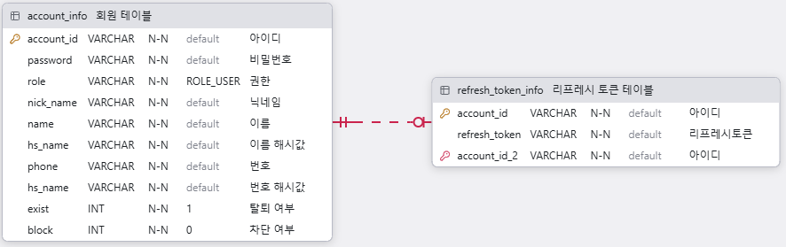

# 소개
JWT 로그인 구현 프로젝트

사용 기술 : Java, Spring Boot, Mybatis, MariaDB, Next.js

## 벡엔드 프로젝트 구조
```
src/main/java/com/example/board/
├── config/       # Security 및 각종 설정
├── controller/   # 컨트롤러
├── dto/          # 요청 / 응답 / 기타 DTO
├── mapper/       # mapper 인터페이스
└── service/      # 서비스

src/main/resources/
└── mapper/       # mpper xml
```

## 프론트엔드 프로젝트 구조
- 프론트엔드 : 오픈 소스 tailAdmin에서 필요한 부분만 일부 변경
- tailAdmin 주소 : https://tailadmin.com
```
src/
├── app/(other-pages)/signup    # 회원가입
├── app/(other-pages)/signin    # 로그인
├── app/(other-pages)/profile   # 내 정보 보기
├── components/
├── context/
├── hooks/
├── icons/
├── layout/
├── lib/
└── utils/
```

## 기능
- 회원가입 / 아이디 찾기 / 비밀번호 찾기
- 로그인 / 로그아웃
- 내 정보 보기 및 수정

## 토큰 저장 위치
- accessToken : localStorage에 저장
- refreshToken : HttpOnly 쿠키와 DB에 저장

## 테이블
